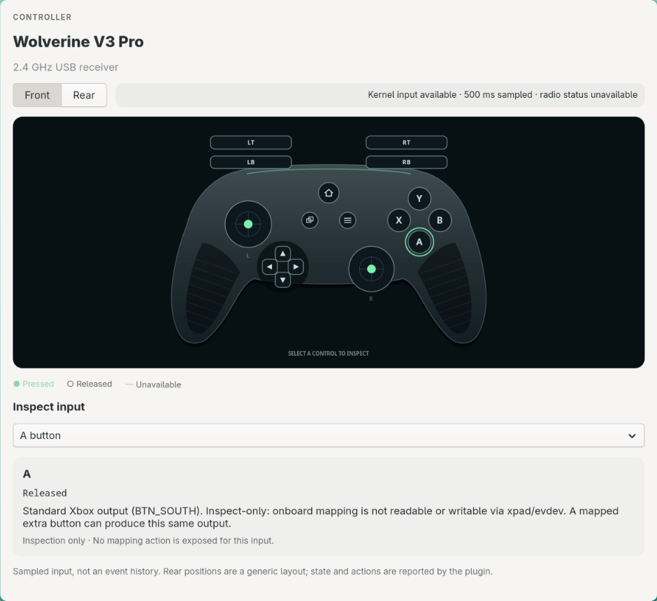
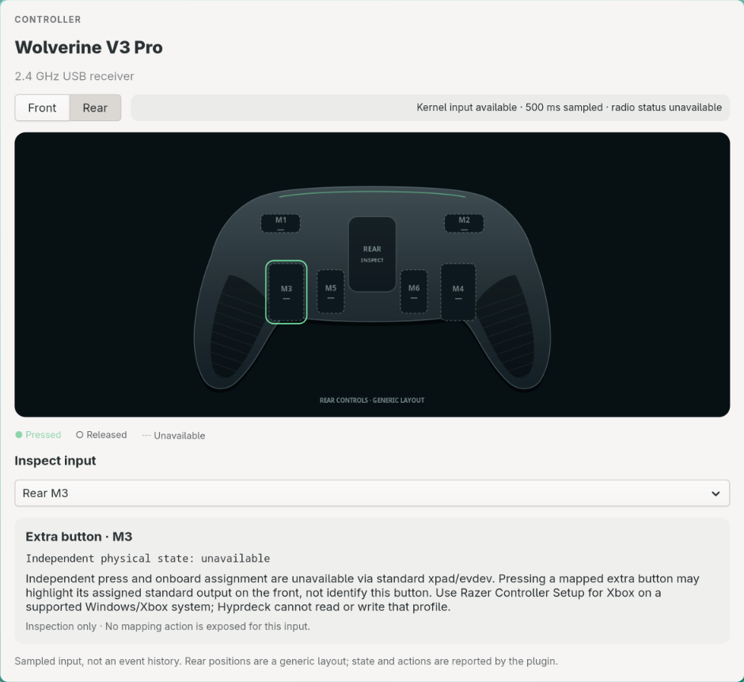

# hyprdeck-razer

Standalone Rust backend for [Hyprdeck](https://github.com/mikkeyboi/hyprdeck). No Razer code is linked into Hyprdeck. The plugin executes as an explicitly trusted, unsandboxed subprocess and also provides a diagnostic CLI.

Version **0.3.0** presents physical product tiles and dedicated pages: one Basilisk Ultimate kit (mouse/receiver and connected charging dock), a separate Wolverine controller, and other physical peripherals. Mouse keyboard/consumer interfaces appear only in **Diagnostics**, never as invented keyboard products. DPI, color/effect, brightness and power forms use actual OpenRazer state and explicit Apply; refresh performs no configuration writes.

<p align="center">
  
  
</p>

Neutral libadwaita screenshots of the native controller view, using a captured real Wolverine
kernel-state snapshot. Rear artwork is a generic layout; dashed controls are unavailable, not
independently mapped or reported buttons. No hardware state was simulated for these images.

## Capabilities and limitations

| Path | Available behavior | Limits |
| --- | --- | --- |
| Live controller diagram | Wolverine `0a3f` front/rear input inspection; detected `0a57`/`0a59` gamepad inputs; pressed standard buttons, D-pad directions, normalized sticks and analog trigger travel | Samples kernel state, not every input event. Unobservable controls are unknown, not falsely released. Independent M1–M6 state and onboard mappings are not available. No diagram mapping/RGB write control is fabricated. |
| Linux USB sysfs | Enumerates every connected vendor `1532` device, including Wolverine `0a3f`, Basilisk Ultimate `0088`, Mouse Dock `007e`, and other Razer peripherals; product/serial, driver, speed, descriptor revision, interrupt-IN scheduling and runtime power state | USB enumeration does not establish controller radio connection or proprietary capabilities. No sysfs writes or kernel-driver replacement. IDs use USB port topology; refresh after moving ports. |
| Read-only, nonexclusive evdev | Current supported controller buttons and absolute axes initialized with kernel ioctls; compact keyboard/mouse button state, relative-axis capabilities; explicit timed changed-input-frame cadence measurement | Never grabs, injects input, sets force feedback or opens devices for writing. Relative mouse movement has no persistent absolute position. Steam/games keep receiving input. Removal and permission failures are explicit. |
| OpenRazer user-session D-Bus | Structured live capability/state snapshots matched using actual `getVidPid`, driver serial/sysfs identity, or uniquely matching PID. Product sections provide real DPI/polling, per-zone RGB/color/effects/brightness, power and actual battery. Every exported `razer.device.*` method remains available in secondary Diagnostics. | Basilisk Ultimate exports current DPI, **not DPI stages, onboard button mapping or macros** in current upstream OpenRazer. Getter values can be daemon/persistent state. Battery uses actual `getBattery` / `isCharging`, never USB revision. Unexported methods and unknown readings never produce guessed controls. |
| Original Wolverine firmware discovery | Explicit HTTPS HEAD check of the verified official shortlink, validated official redirect host/path and updater filename version; official support-page action through the desktop portal | Windows updater discovery only, **not Linux flashing**, not a comparison to installed firmware. Works only for verified original-model `1532:0a3f`. No `.exe` download/execution, Wine or USB firmware packet implementation. |
| fwupd/LVFS | Queries running fwupd for Razer USB firmware devices; manual CLI firmware update only after explicit confirmation, current device-specific vendor identity, supported/updatable metadata flags and nonempty `GetUpgrades` | No claim that Wolverine/Basilisk/Dock is supported. No generic whole-system update, forced firmware, downgrade or fabricated firmware path. The 15-second plugin protocol is deliberately never used to flash firmware. |
| Input Remapper (optional) | Explicit launch of the real mapping/macro editor; saved v2 device-specific presets can be selected and applied/stopped through `input-remapper-control`, selecting a current physical evdev path rather than a guessed device name. | Software remapping, **not onboard Razer profiles**. Requires installed Input Remapper, its privileged service/authorization and permissions. Its service may grab input/create virtual devices only when explicitly applied; ordinary Hyprdeck diagnostics remain read-only/nonexclusive. No autoload or service start on refresh. |

Wolverine onboard profiles, independent paddle assignments, trigger-lock positions and installed firmware are unavailable via standard xpad/evdev. Battery percentage is supplied only if a genuine kernel `power_supply` Battery with a finite `capacity` belongs to that physical device; otherwise it is explicitly unavailable. RGB is a **hardware capability requiring the vendor app**, not absent hardware: [Razer's original Wolverine FAQ](https://mysupport.razer.com/app/answers/detail/a_id/14587) documents brightness/effect/color in Razer Controller Setup for Xbox, no PC Chroma synchronization, and no onboard macros. The wireless receiver's proprietary control envelope is not established for Linux. The controller 3.5 mm headset uses vendor GIP audio, not standard USB Audio; xpad does not supply an ALSA headset. Do not detach a working input driver or invent audio/battery/RGB USB commands.

The xpad [kernel support patch](https://git.kernel.org/pub/scm/linux/kernel/git/stable/stable-queue.git/plain/queue-6.19/input-xpad-add-support-for-razer-wolverine-v3-pro.patch?id=29da4200730c8c1565729677fb61d23daa174e7f) adds `1532:0a57` wired and `1532:0a59` wireless Xbox 360-style input support. [OpenRazer issue #2569](https://github.com/openrazer/openrazer/issues/2569) identifies those as Wolverine V3 Pro **8K PC**, distinct from the original `1532:0a3f` (Xbox One-style xpad). Native input discovery does not replace xpad. The [community driver's reverse-engineering notes](https://github.com/Netruk44/wolverine-v3-pro-linux/blob/main/docs/reverse-engineering.md) describe wired commands while marking the wireless host envelope unknown; they are not evidence that guessed packets work on the user's receiver.

See [controller Linux support evidence](docs/controller-linux-support.md) for the actual
`Generic X-Box pad` source, missing ALSA/battery interfaces, and the scoped `xone` trial that
failed to enumerate this receiver and was rolled back to the working `xpad` binding.

## Controller view

On a product-capable Hyprdeck host, select Wolverine's tile for its native controller diagram, then use **Lighting**, **Buttons & macros**, **Headset audio** or **Diagnostics** for the relevant capability status. Select a front button, trigger, D-pad direction or stick to inspect its output; use the input selector for keyboard-accessible selection. Switch to the rear view to inspect M1–M6 limitations. Pressed standard outputs highlight, sticks display their sampled position, and triggers display normalized travel. Selecting a hotspot **does not remap anything**.

The backend opens evdev nodes **read-only and nonexclusively** and queries `EVIOCGKEY`/`EVIOCGABS`; even an idle controller has initialized supported button and axis values. Axis normalization uses each kernel-advertised minimum/maximum, clamps to valid diagram bounds, and reports invalid/missing ranges as unknown. Signed sticks normalize each side around exact zero, so the asymmetric xpad range `−32768..32767` still centers at zero; unsigned ranges use their midpoint. Stick Y is negative upwards, matching xpad's evdev output; no dead zone, inversion, sensitivity or calibration is written. The Xbox face-button labels follow upstream xpad's `BTN_A/B/X/Y` aliases: `SOUTH=A`, `EAST=B`, `NORTH=X`, `WEST=Y`—the latter two Linux constant names are not their Xbox physical positions.

Refresh targets **500 ms while a known Wolverine USB identity is present**, otherwise **2000 ms**, and only while the host view is mapped. Request/service latency can make actual updates slower; this is a sampled UI, not a 500 ms hardware polling setting, and brief presses between snapshots may not appear. USB receiver presence and a readable kernel snapshot do not independently prove an active radio link. Removal/permission failures replace readings with unknown state rather than keeping stale values. For `0a57`/`0a59`, a diagram is supplied only when a readable node exports actual gamepad button/stick capabilities; those IDs do not imply a particular physical polling limit or independent six-button rear layout. M1–M6 unknown inspection slots are supplied only for the verified original `0a3f` layout.

| Controller opportunity | What Hyprdeck actually provides | Configuration prerequisite / boundary |
| --- | --- | --- |
| Button mapping | Inspect standard mapped outputs by selecting front controls; M1–M6 remain explicitly unknown | Native xpad cannot read/write assignments or tell which independent extra button generated the output. Use model-supported profiles in **Razer Controller Setup for Xbox** on Windows/Xbox. |
| RGB / lighting | Own Lighting section explains the actual hardware capability and offers verified original-model official setup instructions | Brightness/effect/color require Razer Controller Setup for Xbox; the wireless Linux control envelope is unknown. Mouse/dock genuine OpenRazer lighting lives in their own product Lighting section. |
| Polling | Safe original-model 250 Hz wireless / 1000 Hz wired PC Tournament Mode guidance plus explicit changed-input measurement | Wired shortcut is `Function + Menu + A`. The diagram refresh rate, endpoint schedule and changed-event cadence are different quantities; no Linux interval override is offered. |
| Firmware | Original `0a3f` official offered-updater check and Windows instructions | Installed proprietary firmware is unreadable here; the check is neither a version comparison nor a Linux flash. No original-model updater is offered for the other USB identities. |

**Diagnostics** contains physical USB details, all raw input interfaces, historical measurement/vendor results, exported expert OpenRazer methods and firmware support. Product sections reference the same existing groups; raw interfaces never create product cards. Hosts understand the additive product fields and retain the existing groups/visualization fallback; the new native Color/Form controls require a Color/Form-capable Hyprdeck build. Explicit measurement and original-model firmware actions remain reachable from the controller overview; results are device-bound and timestamped in diagnostics, with recorded summaries where available.

The optional visualization schema is vendor-independent: fixed controller input IDs and ordinary declarative controls, not vendor paths, shell commands or arbitrary SVG. This backend attaches **no onboard mapping controls to diagram inputs**, because xpad provides no such capability. The separate Buttons & macros section integrates optional Input Remapper software presets/editor without claiming independent physical rear-button or onboard profile access.

## Basilisk Ultimate product

The verified upstream [Basilisk hardware classes](https://github.com/openrazer/openrazer/blob/master/daemon/openrazer_daemon/hardware/mouse.py) identify `0086` wired and `0088` receiver; the [Mouse Dock class](https://github.com/openrazer/openrazer/blob/master/daemon/openrazer_daemon/hardware/accessory.py) identifies `007e`. A single unambiguous kit is one product with component rows. Multiple same-model mice/receivers remain distinct and an ambiguous dock is not arbitrarily attached. Input-interface names containing Keyboard do not change product identity.

- **Sensitivity:** actual X/Y `getDPI`, device `maxDPI`, and only `getSupportedPollRates` choices. DPI minimum is 100, maximum comes from the real daemon (Basilisk upstream maximum 20000). Supported single-axis devices use advertised DPI choices and Y=0. A stage editor appears only where actual `getDPIStages` / `setDPIStages` exist; Basilisk Ultimate currently has no such API. No stage/profile table is fabricated.
- **Lighting:** mouse logo, scroll wheel, left strip and right strip use their own introspected interfaces. Dock `setBrightness` uses `razer.device.lighting.brightness`, not the mouse zones; dock effects use `razer.device.lighting.chroma`. Forms expose only exported Off/Spectrum/Static/one-/two-/random-color breathing/Reactive/Wave signatures. Native hex color controls select Static explicitly. Reactive duration is 1–4; known Basilisk wave directions are 1/2 and only supported strip zones offer Wave. The receiver's charging color/effect are setter-only: an explicit manual form selects mouse-effect or a supplied hex color without pretending to know current charging configuration.
- **Power/battery:** hardware-backed OpenRazer `getBattery` percentage plus `isCharging`. Unknown `-1` is unavailable, not negative charge. Sleep uses the real hardware's 60–900-second range; low-battery warning is 0–100%. Dock presence never means the mouse is charging.
- **Buttons & macros:** OpenRazer's Basilisk class has neither onboard remapping nor macro methods. Use the optional real [Input Remapper editor](https://github.com/sezanzeb/input-remapper/blob/main/readme/usage.md) to record physical buttons/combinations and create [programmable macros](https://github.com/sezanzeb/input-remapper/blob/main/readme/macros.md). Its v2 presets under `$XDG_CONFIG_HOME/input-remapper-2/presets/<actual device group>/` are surfaced only when present; Apply/Stop calls the actual upstream CLI with a current product event path. Service authorization and successful injection are not inferred from preset files or command exit. Independent buttons not emitted by hardware cannot be recovered through software remapping.

Missing OpenRazer is a single setup status with an explicit upstream-instructions action. Native input continues to work. Installing OpenRazer does not grant unsupported mouse/controller APIs; no package installation, input grab or hardware write occurs during refresh.


## Build and install

Linux x86-64, a current stable Rust toolchain (edition 2024), and the normal Rust linker/build environment are sufficient. No GTK, libusb, Python binding or system OpenSSL library is needed by this binary. HTTPS uses Rustls. OpenRazer, the user-session bus/desktop portal, and fwupd are optional at runtime.

```sh
cargo build --locked --release
cargo test --locked
cargo fmt --all --check
cargo clippy --locked --all-targets -- -D warnings
```

For a local Hyprdeck install, prepare the exact installed layout in a staging directory, then let Hyprdeck validate and install it:

```sh
mkdir -p dist/local
install -m 0755 target/release/hyprdeck-razer dist/local/hyprdeck-razer
install -m 0644 plugin.json dist/local/plugin.json
hyprdeck plugins install ./dist/local
hyprdeck plugins enable razer
hyprdeck plugins state razer
```

Or install the separately published release:

```sh
hyprdeck plugins install mikkeyboi/hyprdeck-razer
hyprdeck plugins enable razer
```

Installation does **not** imply enablement/trust. Hyprdeck installs `plugin.json` and the regular executable (not a symlink) under `$XDG_DATA_HOME/hyprdeck/plugins/razer/`, defaulting to `~/.local/share/hyprdeck/plugins/razer/`. Enabled IDs are recorded under `$XDG_CONFIG_HOME/hyprdeck/plugins.toml`. GUI management/controls are on the Plugins page. Disable with `hyprdeck plugins disable razer`; release checks/updates use `hyprdeck plugins check razer` and `hyprdeck plugins update razer`.

Trust this repository/binary before enabling: it runs as your user without a sandbox. Normal state reads sysfs, opens only connected Razer input nodes read-only and talks to optional OpenRazer/fwupd D-Bus services. Only an explicit control action changes settings. Explicit measurements/vendor checks save device-bound historical results in `$XDG_STATE_HOME/hyprdeck-razer/` (default `~/.local/state/hyprdeck-razer/`), using atomic mode-0600 files. Reconnection identity changes invalidate cached results. No background network request or automatic package installation occurs. An explicit vendor check contacts only allowed official Razer HTTPS hosts; opening instructions uses the user desktop portal. Manual `firmware-update` runs device-specific `fwupdmgr`, which may request Polkit authentication.

### Optional daemon and input permissions

When `org.razer` is absent, the plugin explains the daemon dependency and still shows native controller diagnostics. Follow [OpenRazer's distribution instructions](https://openrazer.github.io/#download) for its kernel modules, daemon, and its **own** device permissions; run `openrazer-daemon` in the desktop user session. `python-openrazer` is not required by this Rust plugin. On Arch/CachyOS the packaged runtime commands include `sudo pacman -S openrazer-daemon fwupd`; install the matching OpenRazer kernel module package from the distribution instructions, and remember fwupd is optional and does not imply Wolverine support. A failed administrative prompt is not a successful install.

For evdev, an active local session normally obtains `uaccess` ACLs. Diagnose permission errors using `getfacl /dev/input/eventN`, your login/seat state and distribution udev policy. **Do not use input-group membership as the default fix:** it grants access to unrelated keyboard input. Do not run Hyprdeck as root, apply broad `chmod`, or detach xpad. OpenRazer sysfs permissions and evdev ACLs are separate.

## CLI and version-1 subprocess API

```sh
hyprdeck-razer state
# Use the input ID shown by state, not a guessed event number:
hyprdeck-razer measure input:usb:1-11:event256 4
hyprdeck-razer firmware-check usb:1-11
hyprdeck-razer action vendor-page '{"device":"usb:1-11"}'
```

The manual CLI emits the same response envelope as the host, pretty-printed. `state` discovers current IDs and controls. `--request` reads one JSON document from stdin, writes exactly one JSON response to stdout, and sends diagnostics only to stderr:

```sh
printf '%s\n' '{"api_version":1,"method":"state","action":null,"args":{}}' | hyprdeck-razer --request
printf '%s\n' '{"api_version":1,"method":"action","action":"measure","args":{"device":"input:usb:1-11:event256","seconds":4}}' | hyprdeck-razer --request
```

Responses are `{ "api_version": 1, "error": null, "state": { "title": ..., "description": ..., "groups": [...], "products": [...], "refresh_interval_ms": 500 } }` while a controller is present (`2000` otherwise). Errors return a string and `state: null`. Actions return refreshed state and their completed result. One request/process, no shell evaluation. The host timeout is 15 seconds; the backend deadline is 13 seconds. Measurements accept 1–8 seconds; normal state does not measure or perform vendor network checks. OpenRazer reads are bounded and concurrent; its 3-second state budget cannot prevent native USB/input diagnostics. Stale cached measurements are labeled historical with their timestamp and are never called current polling.

Version 0.3.0 keeps API version **1** and existing action/CLI/firmware/measurement behavior. `state.products` carries physical `id/name/kind/description/status/connection`, optional real `battery {percentage, charging, source}`, and `sections {id,title,groups}` referencing existing groups. Products use mouse/controller/dock/peripheral kinds, not raw interface kinds. Existing optional `visualization` and `collapsed` groups retain their controller schema. Previously cached groups still deserialize with defaults. Hosts can ignore additive product fields, but **Color/Form are new control variants and require the updated host**; old builds predating those variants may reject the 0.3.0 state, so update Hyprdeck together with this plugin.

### OpenRazer control arguments

Primary product controls use typed **Form** fields (`args.value` is an object) and **Color** (`args.value` is exactly `#RRGGBB`) through `openrazer-configure`; numeric/choice controls validate real device domains before a call. For example a DPI form sends `{"x":800,"y":800}`, not a raw JSON string. Polling accepts only currently advertised choices, sleep 60–900 seconds, brightness/warning 0–100%, and effects revalidate exported method signatures. The backend re-queries capabilities before writing and emits no writes on rendering/refresh. The following raw positional-argument controls remain **expert Diagnostics only**, not the mouse's ordinary user interface.

Text controls accept a JSON array in positional introspected argument order. Examples **only if those methods appear for your current device**:

- `setDPI` (`qq`): `[800,800]`; for a single-DPI device exposing `availableDPI`, upstream requires `[800,0]` and an advertised DPI value.
- `setStatic` (`yyy`): `[0,255,0]`.
- `setDPIStages` (`ya(qq)`): `[1,[[800,800],[1600,1600]]]`; active stages are one-based in the upstream client API.
- `setWave` (`i`): `[1]`; follow the model's available upstream directions.
- `setIdleTime` (`q`, seconds): `[300]`.

JSON arrays encode D-Bus arrays/structs; dictionaries use `[[key,value],...]`, and variants use `{ "signature": "s", "value": "example" }`. Exact integer width/range and shape are checked, integral UI numbers are accepted, fractional integers are rejected. Remaining model-specific semantic constraints are enforced by the real daemon, not fabricated by this plugin. File-descriptor arguments are deliberately unavailable and labeled as such.

Potentially input-changing/destructive methods (reset, pairing, macros, key suppression/game mode and unknown nonlighting/device-specific operations) require an explicit JSON confirmation object:

```json
{"arguments":[true],"confirm":true}
```

For manual or host CLI calls, use:

```sh
hyprdeck-razer action openrazer-call '{"device":"SERIAL_FROM_STATE","interface":"razer.device.dpi","member":"setDPI","arguments":[800,800]}'
```

The daemon serial comes from the OpenRazer group, not the USB/input ID. The method is re-introspected before invocation; stale or unexported operations fail. A successful write means daemon acceptance, not independent device readback. Do not apply a method without reading its upstream semantics; custom matrices and macro APIs on devices that actually export them can alter behavior. Their presence on other OpenRazer models does not imply Basilisk Ultimate onboard macro support.

## Polling: four different quantities

1. **Physical limits:** original Wolverine V3 Pro documentation specifies up to 250 Hz wireless and 1000 Hz wired PC Tournament Mode (`Function + Menu + A`): [original model PC Tournament Mode](https://www.razer.com/console-controllers/razer-wolverine-v3-pro). The Wolverine V3 Pro 8K PC is different hardware. Use a working USB port; changing ports can restore native input without any software workaround.
2. **USB endpoint schedule:** at low/full speed, interrupt `bInterval` counts 1 ms USB frames; at high/super speed it encodes `2^(bInterval-1)` 125 μs microframes ([USB 2.0 specification](https://www.usb.org/document-library/usb-20-specification), §9.6.6). Thus full-speed `bInterval=4` means 4 ms scheduling opportunities (~250/s), not a measured sensor poll. Interface endpoint descriptors are observed, not overridden.
3. **Configured OpenRazer poll rate:** `getPollRate` can reflect daemon/persistent state. An accepted `setPollRate` only exists for a supported daemon device; it is not a Wolverine xpad polling switch.
4. **Observed input cadence:** move sticks/triggers or mouse continuously during explicit measurement. Count only standard-input-bearing `SYN_REPORT` frames, use kernel timestamps, and report elapsed duration, count, valid interval mean/median/p95/min/max and lost frames. Zero changed frames is **idle/no estimate**, not “0 Hz physical polling.” One frame is insufficient. Radio, input filtering/deadzones, timestamps, load and batching affect the sample; this cannot prove every USB report or internal sensor rate.

Never force the `xpad` USB interval, detach a working driver, or write guessed Razer controller USB configuration. Read-only diagnostics coexist with Steam/Big Picture.

## Firmware safety

The official original-model [Windows firmware instructions](https://mysupport.razer.com/app/answers/detail/a_id/14630/~/razer-wolverine-v3-pro-firmware-updater-%7C-rz06-0520) were verified on 2026-10-09: page updated August 14, 2026; updater `v2.04.00_r1`, dated March 12, 2026, “General bug fixes.” The official [download shortlink](https://rzr.to/b556gr) resolved to the `WolverineV3Pro_0A3F_FirmwareUpdater_v2.04.00_r1.exe` Windows binary under `dl.razerzone.com/drivers/WolverineV3Pro/win/`. The explicit check resolves this link live; this dated observation is not a hardcoded “latest” fallback. Failure reports unavailable network/check status. Installed proprietary firmware remains unknown, and USB `bcdDevice` is labeled **descriptor revision**, never installed firmware.

Use a Windows PC and the vendor's exact updater prompts for dongle/controller stages. No native Linux flashing protocol has been established here. The plugin does not silently execute downloads, use Wine, compare unrelated versions, or claim fwupd support merely because it exists.

For a different Razer device that fwupd actually enumerates with current metadata support/updatable flags and upgrades, the deliberately manual route is:

```sh
hyprdeck-razer firmware-update FWUPD_DEVICE_ID_FROM_STATE --confirm
```
Historical, inhibited, wildcard-install, unreachable and emulated fwupd targets are rejected. A wildcard-capable target may update other devices and is not eligible for this explicitly device-scoped command.


Only that validated 40-hex-character device ID reaches `fwupdmgr update`. No force/downgrade/wildcard flags; fwupd's own requirements and interactive authentication still apply. Maintain power and do not interrupt. Never use a host plugin action or a 15-second subprocess supervisor for firmware flashing.

## CI and publishing

CI checks formatting, Clippy, real protocol/type/cadence error-boundary tests, independent release compilation and headless subprocess envelopes. It does not pretend to test connected hardware or an absent OpenRazer daemon. Release builds use Ubuntu 22.04 x86-64 for a conservative glibc baseline rather than distributing an Arch-local binary.

The release workflow runs on `v*` tags, or manual dispatch with an **existing** tag. Keep `Cargo.toml`, the root package in `Cargo.lock` and `plugin.json` versions identical, then create/push the corresponding tag (for example `v0.3.0`). It checks exact repository/manifest/tag identity and publishes three standalone stable-release assets:

- `hyprdeck-razer-linux-x86_64` — the single executable
- `plugin.json` — exact version-1 host manifest
- `hyprdeck-razer-linux-x86_64.sha256` — SHA-256 for the executable asset

Published release assets are immutable in this workflow: rerunning for an existing release refuses replacement. Fixes require a new matching Cargo/manifest version and tag.

Hyprdeck's installer renames the platform binary to the manifest's local `hyprdeck-razer` filename, validates the manifest/checksum and enables only on explicit user trust. Checksums protect integrity, not trust in the publisher. No installer script, auto-publication during local work or automatic firmware update is included.

## Primary API references

This implementation follows live D-Bus introspection and these upstream definitions, not copied firmware/USB command guesses:

- [OpenRazer daemon discovery](https://github.com/openrazer/openrazer/blob/master/daemon/openrazer_daemon/daemon.py) and [object/service naming](https://github.com/openrazer/openrazer/blob/master/daemon/openrazer_daemon/dbus_services/service.py).
- [Base device/current effect APIs](https://github.com/openrazer/openrazer/blob/master/daemon/openrazer_daemon/hardware/device_base.py).
- [Mouse battery, DPI/stages, polling and power methods](https://github.com/openrazer/openrazer/blob/master/daemon/openrazer_daemon/dbus_services/dbus_methods/mamba.py).
- [Device/firmware metadata](https://github.com/openrazer/openrazer/blob/master/daemon/openrazer_daemon/dbus_services/dbus_methods/all.py), [shared lighting/keyboard methods](https://github.com/openrazer/openrazer/blob/master/daemon/openrazer_daemon/dbus_services/dbus_methods/chroma_keyboard.py), and [device-specific methods directory](https://github.com/openrazer/openrazer/tree/master/daemon/openrazer_daemon/dbus_services/dbus_methods).
- [fwupd D-Bus API](https://github.com/fwupd/fwupd/blob/main/src/org.freedesktop.fwupd.xml) and [supported/updatable device flags](https://github.com/fwupd/fwupd/blob/main/libfwupd/fwupd-device.rs).
- [Linux input event semantics](https://docs.kernel.org/input/event-codes.html), including `SYN_DROPPED` recovery.
- [Upstream xpad Xbox button/axis output](https://github.com/torvalds/linux/blob/master/drivers/input/joystick/xpad.c) and [Linux UAPI button aliases](https://github.com/torvalds/linux/blob/master/include/uapi/linux/input-event-codes.h).
- [Input Remapper actual CLI device-path/preset start/stop interface](https://github.com/sezanzeb/input-remapper/blob/main/inputremapper/bin/input_remapper_control.py), [physical interface grouping](https://github.com/sezanzeb/input-remapper/blob/main/inputremapper/groups.py), [preset paths](https://github.com/sezanzeb/input-remapper/blob/main/inputremapper/configs/paths.py) and [real privileged service API](https://github.com/sezanzeb/input-remapper/blob/main/inputremapper/daemon.py).
- [OpenRazer native command bounds](https://github.com/openrazer/openrazer/blob/master/driver/razerchromacommon.c) and [per-zone effect signatures](https://github.com/openrazer/openrazer/blob/master/daemon/openrazer_daemon/dbus_services/dbus_methods/lanceheadte.py).

Licensed MIT; API references remain their upstream licenses. Razer and OpenRazer are independent projects; this is not a vendor-endorsed firmware tool.
