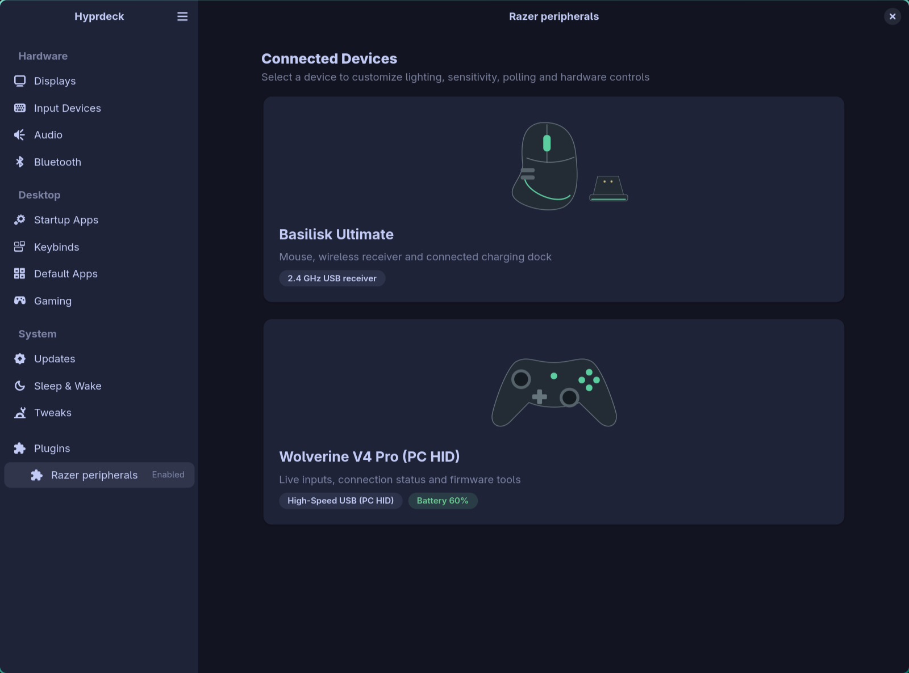
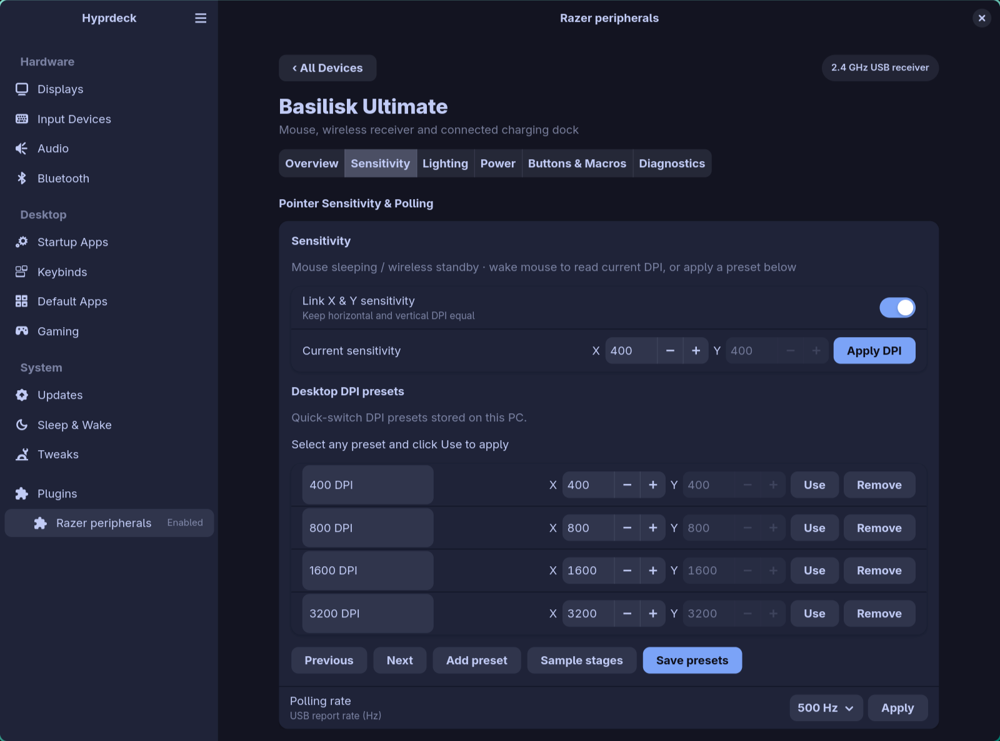
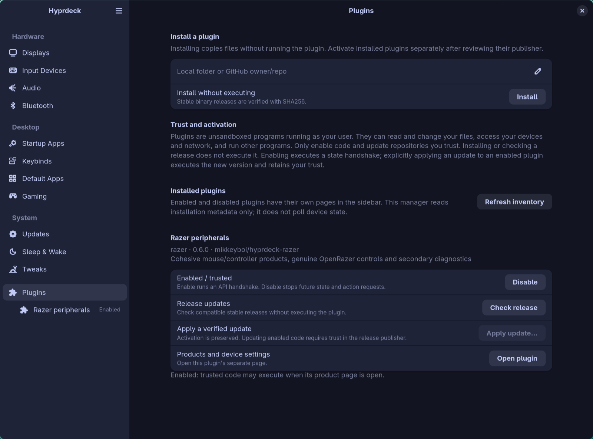

# hyprdeck-razer

Razer peripheral controls for [Hyprdeck](https://github.com/mikkeyboi/hyprdeck), with one page per product—not per USB interface.

## Capabilities

**Basilisk Ultimate + charging dock**
- Linked or independent horizontal/vertical DPI.
- Editable desktop DPI presets, sample stages, and Previous/Next selection.
- Polling choices: **125, 500 and 1000 Hz**.
- Per-zone mouse RGB effects, colors and brightness; separate dock lighting. Unified Chroma Sync offers only effects exported by every primary zone, validates all requested capabilities before writing, and reports daemon failures instead of claiming success.
- Battery/charging status, sleep timeout and hardware low-battery indicator threshold (not the desktop notification threshold).
- Optional software button mapping and macros through [Input Remapper](https://github.com/sezanzeb/input-remapper).

**Wolverine V4 Pro & Wolverine V3 Pro**
- Live controller diagram with a separate low-latency input stream, both sticks, normalized triggers, buttons and D-pad. M1–M6 inputs are independent only when the kernel exposes them independently.
- USB/driver status, Xbox (`1532:0a76`), PC XInput (`1532:0a78`) and PC HID (`1532:0a79`) mode detection, plus input-cadence measurement.
- **Native V4 Pro controls in PC HID mode** (**Function + Menu + Y**): configured polling readback and 250/500/1000/2000/4000/8000-Hz selection; single-button M1–M6 controller assignments, firmware default/disable, and onboard keyboard shortcuts; live battery/charging and installed firmware. Selected writes are read back; unrelated assignments and active profile are preserved. [Permissions and verification](docs/controller-linux-support.md#native-v4-pc-hid-controls).
- Separate **Buttons**, **Keys & Macros**, and **Tools** sections. The timed analyzer reports running/completed/failed status and visible per-stick results; idle input does not produce an invented polling rate or circularity score.
- **Reset USB receiver** appears only in receiver modes with USB write access. HID mode does not offer the irrelevant reset or an unsupported rumble test. A reset ioctl never proves cold-boot recovery.
- Model-specific support links, native V4 installed firmware readback, and the original V3's separate live Windows updater-version check. The V3 updater is never offered for V4.
- Scoped WinBoat passthrough/capture helper for V4 mode re-enumeration; [setup and current protocol evidence](docs/controller-linux-support.md#winboat-usb-diagnostics).

**All OpenRazer devices**
- Product categorization and native vector artwork for supported classes (`mouse`, `controller`, `dock`, `keyboard`, `keypad`, `headset`, `mousemat`, `accessory`); unrecognized categories use generic peripheral artwork.
- Installed firmware and driver versions in Overview when returned by OpenRazer (`getFirmware`, `getDriverVersion`). Unread `0.0`/`v0.0` firmware is reported as unavailable, not as an installed version. Keyboard layout, scroll controls, lighting, DPI presets and power settings appear only for exported capabilities.

<p align="center">
  
  
  
  
  
  
  
  
</p>

Screenshots show the actual app with live device state and the desktop's libadwaita styling.

## Install

Update Hyprdeck first: plugin **0.6.0** requires the compatible host's product pages, native forms with searchable large choices, and controller input-stream support. API version 1 alone does not establish feature compatibility.

```sh
hyprdeck plugins install mikkeyboi/hyprdeck-razer
hyprdeck plugins enable razer
hyprdeck --page plugin:razer
```

Mouse/dock settings require [OpenRazer](https://openrazer.github.io/#download), matching kernel modules, device permissions and a running user daemon. Controller input inspection works independently. Only enable plugins you trust; they run unsandboxed as your user.

**Updates:** `hyprdeck plugins check razer` / `hyprdeck plugins update razer`, or use Hyprdeck’s **Plugins** manager.

## Important limits

- **Desktop DPI presets are not onboard stages.** They do not change the mouse’s physical DPI-cycle button. OpenRazer does not expose Basilisk Ultimate’s onboard stage table, button mapping or macros.
- **Native V4 controls require PC HID mode (`1532:0a79`) and configuration-interface access.** Onboard shortcuts save one key/chord, not recorded macros. Programmable software macros use the separately installed Input Remapper backend. The V4 is explicitly **non-Chroma**; its mode/charging LEDs are not RGB zones. HID mode exposes no evdev force feedback, and the retained native playback API lacks verified units/bounds, so no guessed rumble command is sent. Headset audio remains unavailable. [Driver findings](docs/controller-linux-support.md).
- **Software macro saving is not applying.** Hyprdeck validates and creates new Input Remapper v2 presets without overwriting files. Select the device and apply/stop in Input Remapper's own editor; administrator authentication may be required. Its root daemon exposes ambiguous display-name keys rather than physical device bindings, so Hyprdeck does not offer unsafe automated start/stop or inferred running-state readback.
- The original **V3** supports **250 Hz wireless / 1000 Hz wired Tournament Mode**; V3 8K PC hardware is a separate model. **V4 Pro** advertises up to **8000 Hz on PC**. Detecting a USB personality or measuring changed input frames does not configure or prove the actual polling rate.
- Installed firmware is shown only from real native HID, OpenRazer or fwupd readback; USB `bcdDevice` is never a firmware version. V4 read **1.0.22** on the attached controller. Its official support page lists a pairing utility, not a firmware image; native V4 flashing is unavailable without a verified image/transport. The original V3 updater requires Windows. Available updater versions are never compared with an unknown installed version.
- **OpenRazer desktop battery popups are global across all its battery devices.** The native **Power → OpenRazer battery notifications · all devices** form reads and saves the daemon's actual enable, 1–100% threshold and 0–43200-second check/repeat interval in `$XDG_CONFIG_HOME/openrazer/razer.conf` (otherwise `~/.config/openrazer/razer.conf`). Zero interval disables notifications; it does not mean notify once. Missing values use daemon fallbacks: disabled, 33%, 600 seconds. Notifications may repeat while charging; per-device preferences and independent charging/full alerts are not available. Saves preserve unrelated settings/comments and migrate old `mouse_battery_notifier*` overrides. Invalid or ambiguous files are left unchanged.
- **Saving notification preferences does not apply them to the running daemon.** The separate **Restart OpenRazer to apply** action requires an already-active default-command user service and verifies its next-startup configuration path through systemd's manager/unit environment (including final unsets), then explicitly restarts it for **all Razer devices**, briefly interrupting daemon controls. Custom commands, environment files/PAM/custom roots, and different config directories are refused. Refresh/save never restart it. The form shows saved disk values, not live notifier readback (OpenRazer has no readback API).

Settings change only through explicit **Apply**. **Save presets** writes desktop preferences without changing device DPI.

## Development

[Build, CLI, preset storage and release instructions](docs/DEVELOPMENT.md) · [Hyprdeck plugin API](https://github.com/mikkeyboi/hyprdeck/blob/main/docs/PLUGINS.md) · [MIT license](LICENSE)
